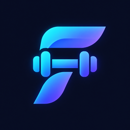
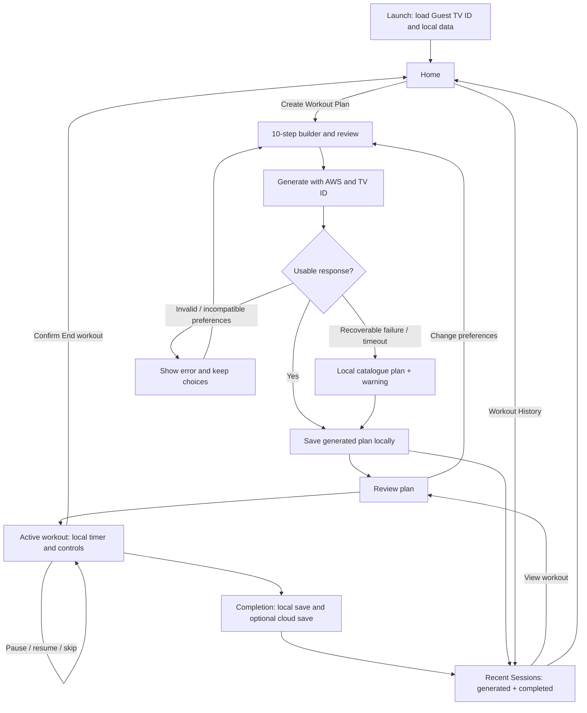
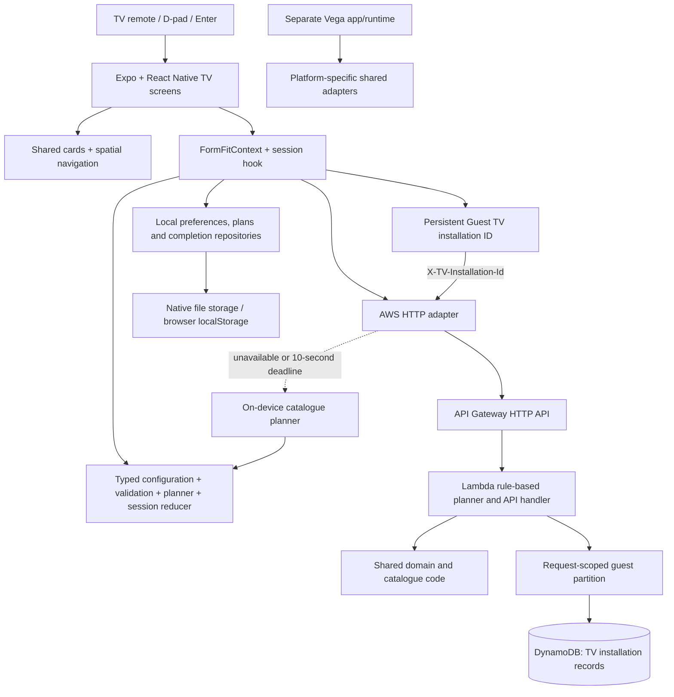
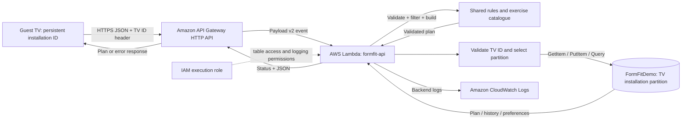
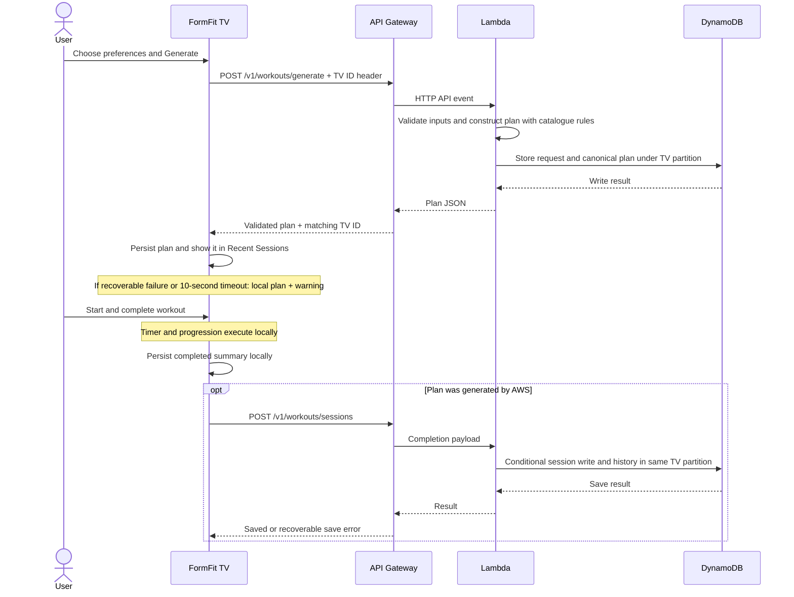
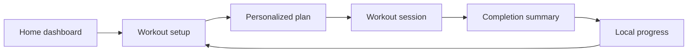

<p align="center">
  
</p>

# FormFit TV

**Personalized workouts, guided from your TV remote.**

[](apps/expo-multi-tv/package.json) [](#aws-integration) [](LICENSE)

FormFit TV turns your goals, available time and equipment into a workout you can follow on the big screen. Build a plan, work through each exercise, and review your progress without reaching for your phone.

Built for the **Build, Ship, Shape: Amazon Developer Hackathon**, targeting the Fire TV track with an AWS-backed workout planner. The project extends Amazon's React Native Multi-TV sample.

[Get started](#getting-started) · [Architecture](#architecture) · [AWS setup](#aws-integration) · [Guest TV identity](#guest-tv-identity) · [Hackathon](#hackathon) · [License](#license)

## Features

- 🎯 **10-step workout builder:** goal, experience, duration, equipment, workout style, body focus, position, recovery, exercises to avoid, and review.
- 🎮 **TV controls:** image-backed cards, readable descriptions, D-pad navigation, a distinct focus glow and checkmarks for selected options.
- ⏱️ **Guided sessions:** exercise timers, sets, rest and transitions; pause, resume, skip or confirm before ending early.
- 📚 **One Recent Sessions list:** generated plans appear immediately alongside completed sessions, with clear status labels. Saved plans can be reopened after restarting.
- 📺 **Guest TV identity:** a persistent installation ID groups cloud data for each TV without sign-in.
- ☁️ **Offline recovery:** AWS handles planning first; recoverable failures or the 10-second deadline trigger local generation with a visible notice.

Planning uses validated catalogue rules. Bedrock, camera-based form analysis and voice coaching are not part of the current implementation.

## How it works

1. **Home:** choose **Create Workout Plan**, **Workout History**, or **Menu** from one row of cards.
2. **Personalize:** complete ten steps. The progress indicator shows three stages at a time; option descriptions explain the effect of each choice.
3. **Generate:** review your preferences and request a plan. It immediately appears in Recent Sessions, even before you start it.
4. **Exercise:** follow the timer and use four session cards to pause/resume, finish the current phase, skip an exercise, or end the session.
5. **Return:** open Workout History to review generated plans and completed sessions. Progress automatically refreshes this guest TV's cloud history and also offers manual refresh.



Use the D-pad to move, OK/Enter to select, and Back to return. A checkmark identifies the saved choice within a group; the glow identifies the control currently in focus.

### TV navigation and presentation

| Interaction | Behavior |
| --- | --- |
| D-pad and OK/Enter | Move focus, then activate or select; focusing an option does not select it |
| Menu | Opens one collapsible sidebar, including Settings |
| Builder | Equal-sized option cards with descriptions and select/deselect controls for multi-select choices |
| Long screens | Focused content is revealed when needed; **Jump to bottom / Back to top** provides a shortcut |
| Home branding | Persistent header with a prominent Guest TV ID; section title follows focused Home content |
| Session actions | Four equal cards in one row; highlight follows remote focus |
| End workout | Confirmation pauses the workout; cancel can resume, confirm returns Home without recording a completion |

## Getting started

### Requirements

| Tool | Development configuration |
| --- | --- |
| Node.js | 22 LTS |
| Yarn | 4.5.0 through Corepack |
| Java | JDK 17 |
| Android Studio | SDK Platform 36, Platform-Tools, Emulator and required Build-Tools |
| Virtual device | Android TV API 36 x86_64, named `Hackathon_TV` |

API 36 is the emulator baseline used for development. The app configuration separately uses compile SDK 36, target SDK 34 and minimum SDK 24; this is not a compatibility certification for every TV version.

### Install and run

```powershell
git clone --branch hackathon https://github.com/mhamzanadeem/react-native-multi-tv-app-sample.git
cd react-native-multi-tv-app-sample
corepack enable
yarn.cmd install --immutable
```

Create `Hackathon_TV` in Android Studio's Device Manager using a **TV system image**, with keyboard and D-pad support enabled. Set `JAVA_HOME` to your JDK 17 installation if needed.

Native build folders are generated locally. On a fresh checkout:

```powershell
$env:EXPO_TV = '1'
yarn.cmd workspace @multi-tv/expo-multi-tv exec expo prebuild --platform android --no-install
yarn.cmd tv:start -CheckOnly
yarn.cmd tv:start
```

The launcher checks the SDK, starts the selected TV, waits for boot, then builds and installs FormFit. For an existing native project, skip prebuild unless its configuration changed. Avoid `--clean` when native files contain custom edits.

- **Different SDK or AVD:** pass `-SdkPath` and `-AvdName` to `tv:start`.
- **Browser preview:** run `yarn.cmd dev:web` and open port 8082.
- **Emulator offline or input unresponsive:** follow the [ADB diagnostics](docs/setup.md#adb-diagnostics-without-a-global-path-change) before changing app code.
- **Launcher icon updates:** rerun the non-clean prebuild and rebuild/install; a Metro refresh alone will not replace native launcher resources.

See [Setup and deployment](docs/setup.md) for the complete Windows walkthrough.

## Architecture

The TV screens, workout rules and data adapters have separate responsibilities. The same catalogue and planning rules run in Lambda and in the local fallback, while the workout timer stays on the TV.



| Area | Responsibility |
| --- | --- |
| `apps/expo-multi-tv` | Expo application, TV build configuration and tests |
| `packages/shared-ui/src/screens/fitness` | Workout screens and user interaction |
| `packages/shared-ui/src/components` | Cards, branding, focus and shared presentation |
| `packages/shared-ui/src/domain` | Configuration validation, session state and progress calculations |
| `packages/shared-ui/src/services` | Planning interfaces and HTTP/backend adapters |
| `packages/shared-ui/src/data` | Exercise catalogue, local repositories and platform storage |
| `infrastructure/lambda` | Request handling and DynamoDB adapter |
| `apps/vega` | Separate Vega runtime and platform-specific concerns |

### Session and storage behavior

- Timers, rest and exercise progression run locally, including when the network drops.
- Generated plans are saved locally immediately. Completed sessions save locally first; cloud-generated plans also trigger a cloud completion save.
- A failed cloud completion save can be retried while its screen is open; there is no persistent retry outbox.
- Preferences, generated plans, completion history and the Guest TV ID survive normal restarts when storage is available. Active sessions and unfinished builder drafts are not restored.
- Recent Sessions combines local and cloud records by ID. A generated plan does not increase completed-workout statistics. Ending early leaves the generated plan available without creating a completion record.
- Up to 200 recent entries are shown. The original media/player code and separate Vega runtime remain in the repository.

## AWS integration

API Gateway receives workout preferences, Lambda validates them and builds a plan, and DynamoDB stores the plan and session records. IAM controls Lambda's table access; CloudWatch collects backend logs.



### Plan generation and fallback

- The normal workout flow calls AWS with a **10-second client timeout**.
- A recoverable failure or timeout triggers the bundled catalogue planner and a visible notice.
- Invalid or incompatible requests remain errors; offline recovery does not bypass their constraints.
- Local recovery produces a new local plan. It does not return a cached AWS plan.

<details>
<summary>Request and completion sequence</summary>



</details>

### Connect your AWS account

| Setting | Where to configure it |
| --- | --- |
| API origin | `CLOUD_DEMO_URL` in `packages/shared-ui/src/services/cloudWorkouts.ts` |
| DynamoDB table | Lambda environment variable `TABLE_NAME`; String keys `pk` and `sk` |
| Lambda runtime | Node.js 22.x, handler `index.handler`, 256 MB, 20-second timeout |
| API routes and stage | API Gateway HTTP API, Lambda payload v2, `$default` with auto-deploy |
| Browser CORS headers | Allow `Content-Type`, `X-Request-Id`, and `X-TV-Installation-Id` |
| Backend deployment | Build with `scripts/build-lambda.ps1`; upload `.validation/formfit-lambda.zip` |

The existing deployment uses `us-east-1`. Follow [AWS deployment instructions](docs/setup.md#configure-your-own-aws-deployment) and the [Lambda guide](docs/lambda-workout-planner.md) for routes, permissions, table records and verification.

### Guest TV identity

- **One installation, one guest:** a `tv-` ID is displayed beneath the app logo. Android stores it in persistent app documents; web uses localStorage. It is not a hardware serial number.
- **Scoped requests:** each cloud call sends `X-TV-Installation-Id`. Lambda validates the format and uses `pk = TV#<installationId>` for that TV's records.
- **Response check:** the client only accepts a success response echoing the same ID. Deploy the matching Lambda package before using the updated app.
- **Restart behavior:** reloading preserves the ID. Clearing app data may remove it; reinstall behavior depends on platform backup restoration. Multiple people using one installation share its guest history.
- **Existing records:** local saved workouts remain. Earlier `DEMO#shared` cloud records are preserved, but are not automatically assigned or exposed to a new guest.
- **Security boundary:** this is unauthenticated guest grouping. Someone who obtains another TV ID can impersonate that guest. Use synthetic demo data; authenticated ownership, cross-TV accounts and household profiles remain future work.

| DynamoDB key | Stored data |
| --- | --- |
| `pk = TV#<installationId>` | Groups one guest installation's records |
| `sk = PLAN#<planId>` | Generated workout, preferences and exercises |
| `sk = REQUEST#<requestId>` | Idempotent generation request and response |
| `sk = SESSION#<sessionId>` | Completed workout attempt |
| `sk = HISTORY#<timestamp>#<sessionId>` | Date-ordered completion history |
| `sk = PREFERENCES` | Guest preferences when the preferences endpoint is used |

The history endpoint returns generated plans and completion summaries for the requesting TV. Health probes use a separate `SYSTEM#health` partition.

See [Guest TV identity and deployment](docs/guest-tv-identity.md) for the rollout steps, CORS settings, verification and limitations.

## Development

```powershell
yarn.cmd workspace @multi-tv/expo-multi-tv typecheck
yarn.cmd workspace @multi-tv/expo-multi-tv exec jest --runInBand --watch=false
```

- Latest focused checks: **110 tests in five suites** passed for guest identity, screen flows, Lambda planning, backend contracts and persistence. Subsequent Home/navigation checks passed **26 tests in three suites**; icon-layout checks passed **6 button tests**. Expo TypeScript checks passed. These are overlapping targeted runs, not an aggregate full-suite count.
- These checks do not replace D-pad and layout verification on a running TV.
- The Expo fitness journey is the current implementation focus. The Vega workspace is preserved, but its fitness-shell integration and native Fire OS/Vega verification are not complete.

### Documentation

- [Setup, emulator diagnostics and AWS deployment](docs/setup.md)
- [Lambda planner and DynamoDB records](docs/lambda-workout-planner.md)
- [API contract](docs/api-contract-v1.md)
- [Guest TV identity, partitions and deployment](docs/guest-tv-identity.md)
- [Brand assets](docs/branding.md)
- [Change groups and commit instructions](docs/commit-plan.md)

## Hackathon

**Target entries: Fire TV track + AWS Builder mini-challenge.**

FormFit turns Amazon's multi-TV sample into a complete fitness experience: choose a routine, follow it with a remote, and save the result. The tables below connect the implementation to the [official requirements](https://amazonappdev2026.devpost.com/rules).

### Fire TV track

| Requirement | FormFit implementation | Evidence |
| --- | --- | --- |
| Fitness application for TV | Workout setup, plan review, guided sessions and progress | [Screens](packages/shared-ui/src/screens/fitness) |
| Interaction suited to the device | D-pad navigation, OK/Enter selection, focus highlights and selected-state checkmarks | [TV controls](packages/shared-ui/src/components/FocusablePressable.tsx) |
| Substantial additions to an existing project | Custom planning, local session execution, persistence and cloud integration extend the original media sample | [Architecture](#architecture) · [Change groups](docs/commit-plan.md) |
| Reproducible implementation | Source, artwork, setup instructions and automated regression tests are included | [Run the app](#getting-started) · [Tests](apps/expo-multi-tv/__tests__) |

### AWS Builder mini-challenge

| Requirement | FormFit implementation | Evidence |
| --- | --- | --- |
| AWS services incorporated into the primary-track project | API Gateway receives preferences; Lambda builds plans; DynamoDB stores plans and completions | [Cloud adapter](packages/shared-ui/src/services/cloudWorkouts.ts) · [Lambda](infrastructure/lambda) |
| Documented integration | Architecture, request flow, configuration, routes and deployment steps | [AWS architecture](#aws-integration) · [Deployment guide](docs/setup.md#configure-your-own-aws-deployment) |
| Demonstrable application behavior | Cloud-generated plans feed the workout session; a 10-second deadline provides visible local recovery | [Application state](packages/shared-ui/src/hooks/FormFitContext.tsx) · [Journey tests](apps/expo-multi-tv/__tests__/formFitScreens-test.js) |

### One-minute review

- **Product:** inspect [Features](#features) and [How it works](#how-it-works).
- **Engineering:** inspect the [architecture diagrams](#architecture), [AWS flow](#aws-integration) and [test commands](#development).
- **Recorded validation:** see [Development](#development) for the latest focused regression runs and their scope; on-device verification remains necessary.

### Submission readiness

- **Implemented:** TV fitness journey, AWS integration, offline recovery, source assets and setup documentation.
- **Still to verify:** final demo video, judge repository access, product feedback, entrant eligibility and submission completion. These are not certified by source code or automated tests.
- **Platform evidence:** the [FAQ](https://amazonappdev2026.devpost.com/details/faqs) accepts Android TV Emulator demos; the [rules](https://amazonappdev2026.devpost.com/rules) refer to Fire OS/Vega. Native Fire OS/Vega verification remains outstanding. Include suitable platform footage or obtain organizer clarification.

## License

[MIT-0](LICENSE), retaining the original Amazon notice. See [licensing and provenance](docs/licensing.md) for details on the sample, contributions and media. MIT-0 permits copying and modification.

<details>
<summary>Earlier project documentation and original media sample reference</summary>

The following documentation is retained for reference. Earlier local-only and future-AWS descriptions are historical; the current FormFit behavior is described above.

# FormFit TV

[](https://reactnative.dev/)
[](https://github.com/AmazonAppDev/react-native-multi-tv-app-sample/blob/main/LICENSE)

FormFit TV is a local, offline fitness coaching experience for the big screen, built on the [Amazon React Native Multi-TV sample](https://github.com/AmazonAppDev/react-native-multi-tv-app-sample). Choose your preferences, review a personalized plan, exercise with a working timer, and revisit your own progress. Plans are generated by deterministic catalogue rules, **not AI**. No account, API key or cloud database is required.

## FormFit product workflow



The Expo shell opens on the FormFit dashboard. Its drawer exposes Workouts, Progress, and the preserved Media sample, Explore, TV and Settings screens. Original video playback and platform-specific player code remain available. The Vega workspace keeps its separate existing navigation/runtime; shared storage and navigation adapters preserve that boundary, but its FormFit shell integration and device verification are future work.

- **Personalize:** general fitness, strength, cardio, mobility or flexibility; beginner/intermediate/advanced; 10/15/20/30/45 minutes; available dumbbells, bands, mat or a stable chair; optional low impact.
- **Review:** actual generated exercise sequence, equipment, muscles, sets/reps, duration estimates, rest and technique/modification cues. No network content is needed.
- **Exercise:** Begin, Pause/Resume, Finish set/rest, Skip exercise, Next exercise and confirmed End session. Remote Play/Pause is supported. Sets, rest and 15-second transitions advance automatically. Backgrounding or losing screen focus pauses the session.
- **Reflect:** actual active time, completed exercise entries, separately labelled skips, and the completion timestamp. Abandoned sessions are not recorded. Manual set completion is user-reported; no physical movement verification or health/calorie estimates are made.
- **Return:** preferences and up to 200 finished-session summaries survive restarts when local storage is available. New installations start with empty progress.

## FormFit architecture

| Source | Responsibility |
| --- | --- |
| `packages/shared-ui/src/screens/fitness` | Dashboard, setup, plan, session, completion and progress presentation |
| `packages/shared-ui/src/components/fitness` | TV-safe layout, high-contrast focusable controls, reading cards and exit confirmation |
| `packages/shared-ui/src/types/workout.ts` | Workout configuration, catalogue and plan contracts |
| `packages/shared-ui/src/data/exercises.ts` | 29 stable exercise IDs with equipment, level, low-impact and technique metadata |
| `packages/shared-ui/src/domain` | Runtime configuration validation, pure session reducer/timeline and progress totals |
| `packages/shared-ui/src/utils/planGenerator.ts` | Deterministic filtering, ordering, circuit construction and timing |
| `packages/shared-ui/src/services/workoutPlanner.ts` | ExerciseRepository/WorkoutPlanGenerator and validated future recommendation contracts |
| `packages/shared-ui/src/data/workoutRepositories.ts` | PreferencesRepository and WorkoutHistoryRepository; versioned, validated, deduplicated local data |
| `packages/shared-ui/src/data/storage.*` | Expo document files, browser localStorage and separate Vega AsyncStorage adapters |
| `packages/shared-ui/src/hooks` | App data provider and timer ownership, pause/background behavior and cleanup |
| `packages/shared-ui/src/navigation` | Existing drawer/stack routes plus the workout journey; a Vega-specific exit-hook adapter |
| `apps/expo-multi-tv/__tests__` | Planner, recommendation safety, session, persistence, timer cleanup, actual screen-flow and existing remote regression tests |

### Planning and timing

The local generator filters by every equipment requirement, level rank, goal and low-impact preference. A stable goal-specific order makes the same preferences produce the same exercise selection. Short general-fitness plans mix upper/lower strength and cardio after a warm-up. Longer plans use a full circuit before repeating an exercise. Generation errors have explicit codes and useful messages.

Duration estimates count timed sets (or four seconds per repetition), between-set rest and 15-second between-exercise transitions. Plans may finish a little short, or up to one minute beyond the target, rather than truncate a set. The pure session reducer uses elapsed timestamps, consumes delayed ticks across phase boundaries, excludes paused time, and refuses terminal-state restarts. A screen owns one interval only while running and focused; listeners and timers are cleaned up. A real native/browser clock is used, not a fake demo countdown.

### Local data and failure behavior

Expo's already installed `expo-file-system@19.0.21` is now declared as a direct app dependency for its document-directory adapter; no dependency version was upgraded. Native preferences/history use `formfit-preferences-v1.json` and `formfit-history-v1.json`; browser preview uses the corresponding localStorage keys. The Vega adapter uses its existing Kepler AsyncStorage. Stored JSON has a versioned envelope and is unencrypted app-local data. It contains only workout preferences and the reported session facts, not credentials or medical metrics.

History writes are serialized and deduplicated by session ID, including retries and React StrictMode effects. If storage is denied, corrupted or unsupported, the repositories keep functioning in memory and display a visible warning. Existing unreadable data is not reset or overwritten. Reinstalling/clearing app data or browser storage removes local history. An in-progress workout and the current draft plan are intentionally not restored after an app restart; regenerate a plan from saved preferences.

### Run and validate FormFit

```powershell
cd C:\tvapp
yarn.cmd tv:start
# Existing supported web preview:
yarn.cmd dev:web
# Validation:
yarn.cmd install --immutable
yarn.cmd workspace @multi-tv/shared-ui run typecheck
yarn.cmd workspace @multi-tv/expo-multi-tv run typecheck
yarn.cmd workspace @multi-tv/expo-multi-tv run lint
yarn.cmd workspace @multi-tv/shared-ui run lint
yarn.cmd workspace @multi-tv/expo-multi-tv run test --watchAll=false --runInBand
```

See the Windows startup section below for SDK/AVD prerequisites and recovery. The current Android package ID and existing native configuration are preserved. The app's Expo display name is FormFit TV; existing generated launcher labels update when their native configuration is regenerated through a reviewed prebuild.

Automated screen-flow tests exercise real screen components with navigation, spatial-focus and storage fixtures; they do not certify D-pad behavior on a physical TV. In this restricted runner, ADB cannot access the Windows profile directory and no browser surface is exposed, so fresh native/visual interaction was not verified. Typechecks, domain/component tests and web/Android JS exports are the available validations. Existing Expo SDK dependency-alignment and Vega peer warnings remain. No camera analysis, exercise videos, voice coach, LLM call, cross-device sync, account system or cloud database has been added to the workout flow.

### Next task: persistent AWS backend

Keep the local catalogue, active timer, cached preferences/history and an offline sync outbox on-device. A future authenticated API can use **API Gateway ? Lambda ? DynamoDB** for account-linked preferences, completed-session history and cross-device sync, following the [AWS HTTP API/Lambda/DynamoDB architecture](https://docs.aws.amazon.com/apigateway/latest/developerguide/http-api-dynamo-db.html). Use stable session IDs and [conditional writes](https://docs.aws.amazon.com/amazondynamodb/latest/developerguide/WorkingWithItems.html) to make retries idempotent; define access patterns and per-user ownership before choosing table keys.

Validate session payloads and catalogue versions in Lambda. Add optional account/device pairing and explicit sync consent; retain the offline guest journey. Future Bedrock recommendations belong behind the service interface on the backend, with local/server constraint validation before a plan reaches the session. The client must never contain AWS credentials. No AWS resources or database connection were created in this implementation.

The following GIF and sample-feature documentation describe the preserved original media application, not a new FormFit demonstration.


## FormFit Mock AWS API lab

Open **Menu ? AWS demo lab** for the offline fixture-backed request/response simulator. Default configuration is mock; no cloud credentials or network are required. Select Beginner / 20 min, inspect JSON and choose Send Mock Request. The normal workout flow and personal history remain local, separate from demo memory.

- [API contract v1](docs/api-contract-v1.md)
- [Future AWS integration points](docs/aws-integration-guide.md)
- [Manual scenario matrix](docs/mock-api-test-scenarios.md)
- [50-minute recording runbook](docs/aws-demo-runbook.md)
- [Cost assumptions, budgets and cleanup](docs/aws-cost-estimate.md)

## Table of Contents

- [Features](#features)
- [Architecture](#architecture)
- [Getting Started](#getting-started)
- [Building and Running](#building-and-running)
- [Development](#development)
- [Project Structure](#project-structure)
- [Technologies](#technologies)
- [Contributing](#contributing)
- [Troubleshooting](#troubleshooting)
- [License](#license)

## Features

### Core Functionality

- **Multi-Platform Support**: Single codebase running on Android TV, Apple TV, Fire TV FOS, Fire TV Vega OS and Web
- **Video Playback**: Integrated video player with [react-native-video](https://github.com/TheWidlarzGroup/react-native-video)
- **Spatial Navigation**: TV-optimized focus management with [React TV Space Navigation](https://github.com/bamlab/react-tv-space-navigation)
- **Remote Control Support**: Native remote control integration for all TV platforms

### UI Components

- **Drawer Navigation**: Customizable left-side drawer with menu items
- **Grid Layouts**: Responsive content grids optimized for TV screens
- **Dynamic Hero Banner**: Header image that updates based on focused content
- **Detail Screens**: Rich content detail pages with metadata and actions

### Video Player Features

- **Overlay Controls**: Custom video controls with spatial navigation support
  - Play/pause button with visual state
  - Seek bar with current time and duration display
  - Exit button to return to previous screen
  - Auto-hide after 5 seconds of inactivity
- **Buffering Indicators**: Visual feedback during video loading and seeking
- **Remote Control Integration**: Full support for play/pause, seek forward/backward (10s intervals), and exit
- **Platform Optimizations**:
  - Native controls on iOS/tvOS
  - Custom overlay on Android TV, Fire TV, and Web
  - Hardware-accelerated rendering on Fire TV Vega with W3C Media APIs

### Dynamic Content Loading

- **External Catalog API**: Fetch movie content dynamically from remote JSON endpoint
- **Rich Metadata Support**:
  - Genres, ratings, and content ratings
  - Release year and duration
  - Trending flags
  - Multiple video source formats
- **Type-Safe Transforms**: Automatic conversion from catalog API format to UI-ready data structures
- **Error Handling**: Graceful fallback and error states for failed API requests
- **Extensible**: Easy to swap catalog endpoint or add new metadata fields

### Architecture

- **Monorepo Structure**: Yarn workspaces with apps and shared packages
- **Shared UI Library**: Reusable components across all platforms
- **Platform-Specific Code**: Automatic resolution of `.android.ts`, `.ios.ts`, `.kepler.ts` files
- **Type Safety**: Full TypeScript support with shared configurations

### App Variants

**expo-multi-tv**

- Universal application built with Expo and react-native-tvos
- Supports Android TV, Apple TV, Fire TV Fire OS, and Web
- Uses React Navigation for screen management
- Cross-platform focus management

**vega**

- Fire TV with Vega OS optimized build using Amazon Vega SDK
- Optimized performance for Fire TV devices
- Native remote control support via TVEventHandler

Both apps share components from the `@multi-tv/shared-ui` package.

## Architecture

This project uses a monorepo structure with Yarn workspaces to manage multiple packages and applications.

```
react-native-multi-tv-app-sample/
├── apps/
│   ├── expo-multi-tv/       # Universal TV app (Android TV, Apple TV, Fire TV FOS, Web)
│   └── vega/                # Fire TV Vega optimized app (Vega SDK)
├── packages/
│   └── shared-ui/           # Shared components, screens, and navigation
├── package.json             # Workspace configuration
└── tsconfig.base.json       # Shared TypeScript configuration
```

### Architecture Overview

```
┌─────────────────────────────────────────────────────────┐
│       React Native Multi-TV Monorepo                    │
├──────────────────────────┬──────────────────────────────┤
│ Apps                     │ Packages                     │
├──────────────────────────┼──────────────────────────────┤
│ expo-multi-tv            │ shared-ui                    │
│   ├─ Expo SDK 54         │   ├─ Components              │
│   ├─ React Navigation    │   ├─ Screens                 │
│   ├─ react-native-tvos   │   ├─ Navigation              │
│   └─ Platforms:          │   ├─ Hooks                   │
│       • Android TV       │   ├─ Theme                   │
│       • Apple TV         │   └─ Remote Control          │
│       • Fire TV          │       ├─ .android.ts         │
│       • Web              │       ├─ .ios.ts             │
│                          │       └─ .kepler.ts          │
│ vega                     │                              │
│   ├─ Vega SDK            │                              │
│   ├─ @amazon-devices/*   │                              │
│   └─ Platform: Vega OS   │                              │
└──────────────────────────┴──────────────────────────────┘
```

The `@multi-tv/shared-ui` package contains all reusable UI components, screens, and navigation logic. Platform-specific implementations use file extensions (`.android.ts`, `.ios.ts`, `.kepler.ts`) that Metro bundler automatically resolves at build time.

## Getting Started

### Prerequisites

Before you begin, ensure you have the following installed:

- **Node.js**: v18 or higher
- **Yarn**: v4.5.0 (configured via packageManager field)
- **Platform-specific tools**:
  - **Android TV**: Android Studio with Android SDK
  - **Apple TV**: Xcode (macOS required) with tvOS SDK
  - **Fire TV**: [Amazon Vega SDK](https://developer.amazon.com/docs/vega/0.21/install-vega-sdk.html)
  - **Web**: Modern web browser

### Installation

Clone the repository and install dependencies:

```bash
# Clone the repository
git clone https://github.com/AmazonAppDev/react-native-multi-tv-app-sample.git
cd react-native-multi-tv-app-sample

# Install all dependencies
yarn install
```

## Building and Running

### Quick Start

Run the universal app on different platforms:

```bash
# Android TV and Fire TV FOS
yarn dev:android

# Apple TV
yarn dev:ios

# Web
yarn dev:web

```

### Platform-Specific Instructions

#### Android TV

1. Start Metro bundler:

   ```bash
   yarn dev
   ```

2. In a new terminal, run on Android TV:
   ```bash
   yarn dev:android
   ```

Or directly from the app directory:

```bash
cd apps/expo-multi-tv
yarn android
```

#### Apple TV

1. Start Metro bundler:

   ```bash
   yarn dev
   ```

2. In a new terminal, run on Apple TV:
   ```bash
   yarn dev:ios
   ```

Or directly from the app directory:

```bash
cd apps/expo-multi-tv
yarn ios
```

#### Web - Useful for LG WebOS and Tizen

Development server:

```bash
yarn dev:web
```

Or directly from the app directory:

```bash
cd apps/expo-multi-tv
yarn web
```

Production build:

```bash
cd apps/expo-multi-tv
npx expo export --platform web
npx serve dist
```

#### Fire TV (Vega)

For the Fire TV optimized build:

```bash
# Development build
yarn dev:vega

# Production build
yarn build:vega

# Debug build
yarn build:vega:debug
```

Or directly from the app directory:

```bash
cd apps/vega
yarn build
```

### Available Commands

#### Workspace Commands

| Command            | Description                       |
| ------------------ | --------------------------------- |
| `yarn dev`         | Start expo-multi-tv Metro bundler |
| `yarn dev:android` | Run on Android TV                 |
| `yarn dev:ios`     | Run on Apple TV                   |
| `yarn dev:web`     | Run on Web                        |
| `yarn dev:vega`    | Start vega Metro bundler          |
| `yarn build:vega`  | Build vega for Fire TV            |
| `yarn format`      | Format code with Prettier         |
| `yarn clean:all`   | Clean all node_modules            |

#### App-Specific Commands

Navigate to the app directory first:

```bash
# expo-multi-tv
cd apps/expo-multi-tv
yarn start      # Start Metro bundler
yarn android    # Run on Android TV
yarn ios        # Run on Apple TV
yarn web        # Run on Web
yarn test       # Run tests
yarn lint       # Lint code

# vega
cd apps/vega
yarn start      # Start Metro bundler
yarn build      # Build for Fire TV
yarn test       # Run tests
yarn lint       # Lint code
```

## Development

### One-command Android TV startup (Windows)

From the repository root on the existing `hackathon` branch:

```powershell
cd C:\tvapp
yarn.cmd tv:start
```

Prerequisites: Node.js compatible with this Expo checkout, Yarn 4.5.0, dependencies installed with `yarn.cmd install --immutable`, JDK 17 (Java on PATH and a valid JAVA_HOME if set), and the existing generated `apps/expo-multi-tv/android` project. In Android Studio's SDK Manager install Platform-Tools, Android Emulator, the project's SDK platform (currently API 36), and build tools requested by Gradle. Accept SDK licenses there. Device Manager should contain an Android TV AVD named `Hackathon_TV` with its system image installed and Windows virtualization enabled.

The launcher discovers the SDK from `ANDROID_HOME`, `ANDROID_SDK_ROOT`, existing `local.properties`, common SDK locations, or tools on PATH, validating both executables before use. It sets SDK variables/PATH only in its child process, updates only `sdk.dir` in the ignored native `local.properties`, lists devices, reuses a running TV emulator, or starts `Hackathon_TV` and waits up to five minutes for Android and its package manager. It then calls the existing `yarn.cmd dev:android` workflow with the selected AVD name. Phones are not selected. Offline unidentified emulators cause a clear stop to avoid duplicate startup. It neither installs dependencies nor runs a clean prebuild. A failed build remains a failed command.

```powershell
# Read-only project diagnostics; does not write properties, boot an AVD, or build.
yarn.cmd tv:start -CheckOnly
# For a custom SDK location, copy the real Android SDK Location from SDK Manager.
yarn.cmd tv:start -SdkPath "D:\Android SDK"
# Optional: select another existing TV AVD or extend the boot timeout.
yarn.cmd tv:start -AvdName Hackathon_TV -BootTimeoutSeconds 600
```

For an undetected SDK, open Android Studio > Settings > Languages & Frameworks > Android SDK, or Tools > SDK Manager, and copy **Android SDK Location**. For a missing AVD, create one in Device Manager using an Android TV device/system image and the required name. If an emulator is offline, allow it to finish starting or close it through Device Manager and retry. For startup/boot failures, launch it in Device Manager to inspect the system-image or virtualization error. The launcher leaves emulators running on failure and never wipes their data.

If ADB reports `\.android` or permission denied, run this command in a normal PowerShell terminal under your Windows account, outside any restricted automation sandbox. Check your profile path and any `ANDROID_USER_HOME`, `ANDROID_EMULATOR_HOME`, or `ANDROID_AVD_HOME` overrides; correct stale overrides in that terminal. Inspect the affected directory's ownership/permissions with Windows Properties > Security, or ask your administrator if policy-managed. Do not delete `.android`, reset ADB keys, or loosen ACLs. Android's directory variables are documented in [Android SDK environment variables](https://developer.android.com/tools/variables). The launcher reports this failure without attempting a security workaround.

The root command locates Windows PowerShell through `SystemRoot`, so PowerShell itself need not be on PATH. Its `-ExecutionPolicy Bypass` applies only to that launched process and does not change saved user/machine policies; organization-enforced policy still takes precedence. The script also supports PowerShell 7 when invoked directly with `pwsh -File ./scripts/start-tv.ps1`. SDK/PATH changes do not persist in the parent terminal, so a standalone `adb` command there may still need its full SDK path.

Press **Ctrl+C** to stop the development server/build. To close just the app, use the emulator's Home button. To stop the emulator, close its window or stop it in Device Manager. For a command-line stop, use the discovered SDK's full ADB path and the serial printed by the launcher: `& "<SDK>\platform-tools\adb.exe" -s emulator-5554 emu kill` (replace the example serial with your actual device).

### Hackathon validation on Windows

Use Yarn 4.5.0. If PowerShell blocks `yarn.ps1`, use `yarn.cmd` for the same commands.

```powershell
yarn.cmd install --immutable
yarn.cmd workspace @multi-tv/shared-ui run typecheck
yarn.cmd workspace @multi-tv/expo-multi-tv run typecheck
yarn.cmd workspace @multi-tv/shared-ui run lint
yarn.cmd workspace @multi-tv/expo-multi-tv run lint
yarn.cmd workspace @multi-tv/shared-ui run test --runInBand --silent
yarn.cmd workspace @multi-tv/expo-multi-tv run start
```

Yarn uses workspace-limited node_modules hoisting. Shared native/UI imports are peer dependencies supplied by each app; `mitt` and `@bam.tech/lrud` are direct shared dependencies. `tsconfig.consumer.json` resolves shared peer types against the primary Expo app without installing another React or React Native runtime in shared UI. The shared typecheck keeps its full source include and checks Vega media imports against installed Vega packages, but it does not certify the Vega runtime against Expo's React 19/TV native types. Vega still uses its own runtime and Metro aliases.

Shared lint and tests use the Expo workspace's existing ESLint/Babel/Jest toolchain. The shared test command intentionally runs the common suite in `apps/expo-multi-tv/__tests__` with watch mode disabled. The original planner regression matrix covers 600 goal/level/duration/equipment combinations, with additional tests for new goals, low impact, chairs, sessions and persistence. The planner repeats complete eligible circuits for longer sessions; repeated exercise IDs across circuits are intentional. Estimates include inter-set rest and 15-second transitions, and can finish short of the target when the next exercise would exceed the one-minute overshoot allowance.

Metro remote configuration is loaded before navigation roots mount so both TV remotes and web keyboard focus can subscribe. Validate actual focus, drawer/Back navigation, video seeking and pause on Android TV after building. A successful Metro export verifies bundling, not native playback or device behavior.

Expo SDK 54 is compatible with React 19.1 and React Native TV 0.81, but this checkout has older Expo module versions, react-native-web 0.19, a pre-release TV runtime and an SDK-51-era TV config plugin. Run `yarn.cmd workspace @multi-tv/expo-multi-tv exec expo install --check` before a coordinated native dependency alignment. Do not use `--fix` or clean prebuild automatically; preserve the native TV configuration and separate Vega dependencies.


### Project Structure

The monorepo contains the following packages:

#### `@multi-tv/expo-multi-tv`

Universal TV application built with Expo, supporting Android TV, Apple TV, Fire TV, and Web.

**Key Technologies:**

- Expo SDK 54
- React Navigation 7
- react-native-tvos
- React TV Space Navigation

#### `@multi-tv/vega`

Fire TV optimized application using Amazon's Vega SDK.

**Key Technologies:**

- Amazon Vega SDK
- @amazon-devices packages
- Native Fire TV remote integration
- Custom navigation optimizations

#### `@multi-tv/shared-ui`

Shared component library used by both applications.

**Exports:**

- **Components**: `FocusablePressable`, `CustomDrawerContent`, `MenuContext`
- **Screens**: `HomeScreen`, `DetailsScreen`, `PlayerScreen`, `ExploreScreen`, `TVScreen`
- **Navigation**: `DrawerNavigator`, `RootNavigator`, `AppNavigator`
- **Hooks**: `scaledPixels`, `useMenuContext`
- **Theme**: Centralized theming configuration
- **Remote Control**: Platform-specific remote control managers

### Adding New Features

1. Develop shared components in `packages/shared-ui/src/`
2. Add platform-specific implementations using file extensions:
   - `.android.ts` for Android TV
   - `.ios.ts` for Apple TV
   - `.kepler.ts` for Fire TV
3. Export from `packages/shared-ui/src/index.ts`
4. Import in apps via `@multi-tv/shared-ui`

Example:

```typescript
// packages/shared-ui/src/components/MyComponent.tsx
export const MyComponent = () => {
  /* ... */
};

// packages/shared-ui/src/index.ts
export { MyComponent } from './components/MyComponent';

// apps/expo-multi-tv/App.tsx
import { MyComponent } from '@multi-tv/shared-ui';
```

### Remote Control Implementation

The project includes platform-specific remote control managers:

| Platform               | Implementation                    | Technology            |
| ---------------------- | --------------------------------- | --------------------- |
| Android TV/Fire TV FOS | `RemoteControlManager.android.ts` | react-native-keyevent |
| Apple TV               | `RemoteControlManager.ios.ts`     | Native tvOS events    |
| Fire TV Vega OS        | `RemoteControlManager.kepler.ts`  | Kepler TVEventHandler |

All managers implement `RemoteControlManagerInterface` and integrate with `react-tv-space-navigation`.

#### Remote Control Key Mappings

The following keys are supported across all platforms in the video player:

| Key/Button   | Action                   | Platforms           |
| ------------ | ------------------------ | ------------------- |
| PlayPause    | Toggle play/pause        | All                 |
| Select/Enter | Activate focused item    | All                 |
| Back         | Exit player or go back   | All                 |
| Left         | Seek backward 10 seconds | All (in player)     |
| Right        | Seek forward 10 seconds  | All (in player)     |
| FastForward  | Seek forward 10 seconds  | All (in player)     |
| Rewind       | Seek backward 10 seconds | All (in player)     |
| Up/Down      | Navigate menu items      | All (in navigation) |

**Platform-Specific Notes:**

- **iOS/tvOS**: Uses native video controls by default; custom overlay disabled
- **Android TV/Fire TV**: Custom overlay with spatial navigation for all controls
- **Web**: Keyboard support with arrow keys and spacebar for play/pause
- **Fire TV Vega**: Hardware-accelerated video with W3C Media APIs

## Technologies

This project is built with modern React Native and TV development tools:

| Technology                | Version | Purpose                    |
| ------------------------- | ------- | -------------------------- |
| React Native              | v0.81   | Core framework (tvOS fork) |
| Expo                      | SDK 54  | Development platform       |
| TypeScript                | v5.7    | Type safety                |
| Yarn Workspaces           | v4.5    | Monorepo management        |
| React Navigation          | v7      | Screen navigation          |
| react-tv-space-navigation | v6.0.0-beta1   | TV focus management        |
| react-native-video        | Latest  | Video playback             |
| Amazon Vega SDK           | Latest  | Fire TV Vega OS            |

## Contributing

Contributions are welcome! This project is an open-source sample designed to help developers build TV applications.

### How to Contribute

1. Fork the repository
2. Create a feature branch (`git checkout -b feature/amazing-feature`)
3. Make your changes
4. Run tests and linting (`yarn test:all && yarn lint:all`)
5. Commit your changes (`git commit -m 'Add amazing feature'`)
6. Push to the branch (`git push origin feature/amazing-feature`)
7. Open a Pull Request

### Development Guidelines

- Follow the existing code style
- Write tests for new features
- Update documentation as needed
- Ensure all tests pass before submitting PR
- Use conventional commit messages

## Troubleshooting

### iOS Build Issues

**Error: "can't access lexical declaration 'X' before initialization"**

- This typically occurs when functions are referenced before they're defined
- Solution: Functions should be defined before useEffect hooks that reference them

**Error: "No such file or directory: node"**

- The Xcode build can't find the Node.js binary
- Solution: Update `apps/expo-multi-tv/ios/.xcode.env.local` with correct Node path:
  ```bash
  export NODE_BINARY=/opt/homebrew/bin/node  # or your node path
  ```
- Find your node path with: `which node`
- Note: `.xcode.env.local` is gitignored (machine-specific configuration)

**Pods Installation Issues**

- Clean and reinstall:
  ```bash
  cd apps/expo-multi-tv/ios
  rm -rf Pods Podfile.lock
  pod install
  ```

### Android TV Build Issues

**Metro Bundler Port Conflicts**

- If port 8081 is in use:
  ```bash
  yarn start --port 8082
  ```

**ADB Device Not Found**

- Ensure Android TV/Fire TV is connected:
  ```bash
  adb devices
  adb connect <device-ip>:5555
  ```

### Fire TV Vega Issues

**Vega SDK Not Found**

- Ensure Vega SDK is installed and in PATH
- Check SDK path: `echo $KEPLER_SDK_HOME`
- Download from: [Amazon Vega Developer Portal](https://developer.amazon.com/vega)

### Web Platform Issues

**Video Player White Screen**

- Check browser console for JavaScript errors
- Ensure catalog API is accessible
- Verify video URLs are CORS-enabled

**Spatial Navigation Not Working**

- Use keyboard arrows for navigation on web
- Focus management requires keyboard or gamepad input

### Common Issues

**"Module not found" Errors**

- Clear cache and reinstall:
  ```bash
  yarn clean:all
  yarn install
  ```

**TypeScript Errors**

- Run type checking:
  ```bash
  yarn typecheck
  ```

**Video Playback Issues**

- Verify video URLs are accessible
- Check network connectivity
- Ensure video format is supported (MP4 recommended)

## License

This project is licensed under the MIT-0 License - see the [LICENSE](./LICENSE) file for details.

## Resources

- [React Native TV OS](https://github.com/react-native-tvos/react-native-tvos) - TV platform support
- [React TV Space Navigation](https://github.com/bamlab/react-tv-space-navigation) - Spatial navigation library
- [Amazon Kepler Developer Portal](https://developer.amazon.com/vega) - Fire TV development resources
- [Expo Documentation](https://expo.dev) - Expo SDK documentation

## Support

For questions, issues, or feature requests, please open an issue on GitHub.

---

Made for TV app developers


</details>
